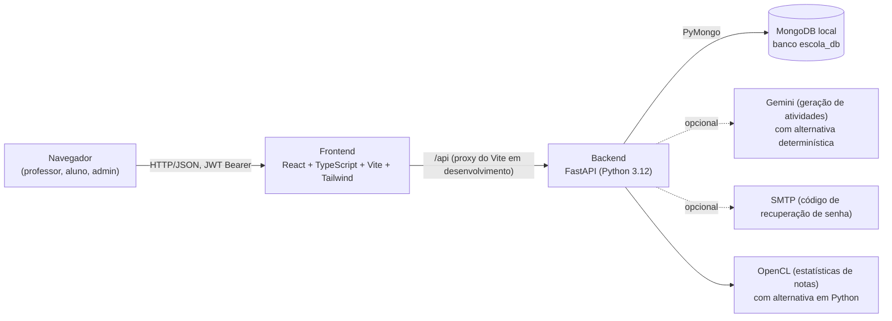
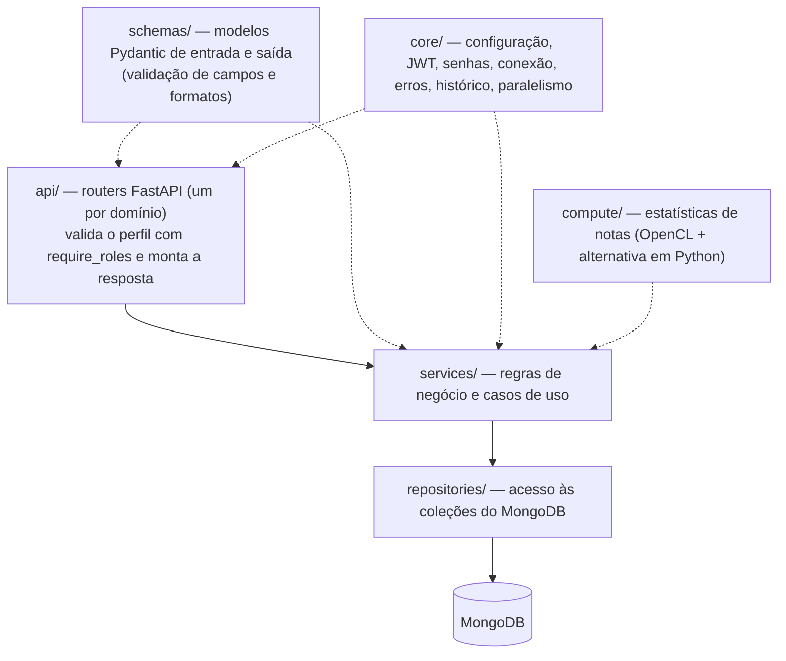

# Arquitetura do PlusEduc

Documento atualizado nas Sprints 09 e 10 para refletir o que está implementado (e não apenas o que foi planejado nas Sprints 01 e 02).
Cada afirmação aqui foi conferida no código ou nos testes; o que ainda não existe aparece em "Fora do escopo atual".

## Visão geral

O sistema é um monorepo com duas aplicações: `PlusEduc-UI` (interface) e `PlusEduc-BE-Python` (API). A comunicação é só HTTP/REST com JSON;
não há WebSocket nem fila. O banco é um MongoDB local sem esquema fixo.

## Backend (`PlusEduc-BE-Python/app`)

Arquitetura em camadas, com dependências sempre apontando para baixo:

| Pasta | Responsabilidade |
|---|---|
| `api/` | `auth`, `students`, `student_analytics`, `teachers`, `classrooms`, `grades`, `activities`, `activity_submissions`, `student_portal`, `teacher_corrections`, `subject_catalog`, `subject_topics`, `reports` (dashboard, relatórios e pesquisa), `audit`, `health` |
| `services/` | uma classe por caso de uso (ex.: `ClassroomService`, `GradeService`, `ActivitySubmissionService`, `ReportService`, `AuditService`), mais `curriculum` (matérias por série, BNCC), `gemini_service` e `demo_ai_service` (geração de atividades), `email_service`, `activity_pdf_service`, `report_export` (CSV, Excel e PDF) |
| `repositories/` | um repositório por coleção; resolvem ids em texto ou `ObjectId`, consultas em lote (`find_by_ids`) e índices |
| `schemas/` | contratos da API e validações (tamanhos, e-mail, datas, faixas de nota) |
| `core/` | `config` (variáveis de ambiente), `jwt`, `passwords` (bcrypt), `database`, `errors` (resposta de erro padronizada), `audit_middleware` (histórico), `parallel` (consultas simultâneas), `logging_config` |
| `compute/` | `grade_stats` e o kernel OpenCL `grade_stats.cl`: média, frequência e última data por aluno/disciplina |
| `scripts/` | `seed_demo_population`, `serve` (vários processos), `build_backend` (bytecode, `--nuitka`, `--standalone`), `benchmark_opencl`, `benchmark_services` |

### Segurança (fluxo de uma requisição)

1. O `CORSMiddleware` só aceita as origens de `CORS_ALLOWED_ORIGINS`.
2. `get_current_user` valida o token (assinatura HS256, validade e **tipo `access`**; o refresh token não abre a API), busca o usuário **ativo** no banco e usa o **papel gravado no banco**, nunca o do token.
3. `require_roles(...)` devolve 403 se o papel não serve. Rotas com regra por registro (desempenho de aluno, PDF de atividade) conferem a posse dentro do serviço.
4. O `AuditMiddleware` registra no histórico toda escrita (POST, PUT, PATCH, DELETE), com autor, resultado e, nas notas, antes e depois.
5. Erros viram JSON padronizado (`timestamp`, `status`, `error`, `message`, `details` nas validações); exceções não tratadas devolvem mensagem genérica, sem rastros internos.

Perfis: `TEACHER` e `ADMIN` (mesmas rotas de gestão; o admin vê o histórico de todos e aprova os cadastros públicos de professor), `STUDENT` (apenas `/api/student-portal/**` e os próprios dados).
A matriz completa de rotas por perfil está em `docs/sprint-08/resultados/matriz_de_permissoes.md`.

### Configuração

Tudo por variáveis de ambiente (`.env` local, nunca versionado; modelo em `.env.example`): banco, CORS, JWT, Gemini, SMTP, recuperação de senha
(`PASSWORD_RESET_DEMO_MODE`, desligado por padrão), OpenCL e o ambiente (`APP_ENV`). Quando `APP_ENV` começa com `test` o histórico fica desligado.

## Frontend (`PlusEduc-UI/src`)

| Pasta | Conteúdo |
|---|---|
| `app/routes.tsx` | rotas com carregamento sob demanda (cada tela é baixada ao abrir) e a rota `*` de "Página não encontrada" |
| `app/components/` | `DashboardLayout` e `Sidebar` (professor/admin), `StudentLayout` e `StudentSidebar` (aluno), pesquisa global, filtros, notificações e componentes de interface (Radix) |
| `app/pages/` | telas do professor (Dashboard, Turmas, Atividades, Notas e Frequência, Relatórios, Histórico, Matérias, Configurações...) e `pages/student/` (portal do aluno) |
| `contexts/AuthContext` | sessão (tokens e perfil no `localStorage`), login, cadastro e logout |
| `services/` | cliente HTTP (`api.ts`: cabeçalho de autenticação, tradução de erros, encerramento da sessão em 401) e um serviço por domínio |
| `types/`, `hooks/`, `utils/`, `styles/` | tipos TypeScript, hooks, utilitários e tema (claro/escuro) |

Proteção de rotas: `DashboardLayout` leva o aluno para `/aluno`; `StudentLayout` leva o professor para `/dashboard`; sem login, ambos levam a `/login`.
Essa proteção é de conveniência; a segurança de verdade está no backend.

## Execução, build e distribuição

* **Desenvolvimento:** `uvicorn app.main:app` e `npm run dev` (o Vite encaminha `/api` para o backend; destino configurável em `VITE_DEV_PROXY_TARGET`).
* **Testes:** `pytest` (suíte com banco real configurável por `MONGODB_DATABASE`) e `npm run type-check` + `npm run build`.
* **Build do backend:** `scripts/build_backend.py` gera só bytecode, código nativo (`--nuitka`) ou o servidor inteiro (`--standalone`).
* **Versão desktop** (janela própria, instalador e atualização automática) fica na branch `feat/desktop-installer`, fora da `main`.

### Sessão (Sprint 10)

O login devolve um token de acesso (8 h) e um refresh token (7 dias). O cliente HTTP (`services/api.ts`) renova a sessão em
`POST /api/auth/refresh` quando o token de acesso vence ou a API responde 401, uma renovação por vez; se a renovação falhar, a
sessão é encerrada e a tela de login avisa. O cadastro público de professor nasce pendente (`users.pendingApproval`) e só o ADMIN
ativa (`/api/teachers/{id}/approve`).

### Documentação da API

`app/api/openapi_docs.py` completa o esquema OpenAPI (descrição, grupos em português, resumo e perfil de acesso de cada rota).
O mesmo esquema serve o Swagger (`/docs`), o ReDoc (`/redoc`) e o `docs/API.md` (`scripts/export_api_docs.py`);
`tests/test_openapi_docs.py` confere que nenhuma rota fica sem documentação e que o acesso documentado bate com a matriz de permissões.

## Fora do escopo atual (pendente)

* Predição de risco, clustering de perfis e otimização de grupos de reforço (RF19, RF21, RF22).
* Escopo de dados por turma/professor (qualquer professor lê e lança notas em qualquer turma).
* Integração contínua (GitHub Actions): os testes são executados manualmente.
