# Manual do Usuário — PlusEduc

**Versão do sistema:** 1.0.0-rc.1 · **Grupo 08** · Fábrica de Software + Tópicos Avançados · UNINASSAU · novembro de 2026

Este manual explica como usar o PlusEduc no dia a dia da escola. Ele foi escrito para professores, coordenação e alunos;
não é preciso conhecer nada de programação. As imagens foram capturadas no sistema em funcionamento, com dados de
demonstração.

## Sumário

1. [O que é o PlusEduc](#1-o-que-é-o-pluseduc)
2. [Para quem é](#2-para-quem-é)
3. [Acesso ao sistema](#3-acesso-ao-sistema)
4. [Visão geral da tela](#4-visão-geral-da-tela)
5. [Professor: passo a passo](#5-professor-passo-a-passo)
6. [Administrador (coordenação)](#6-administrador-coordenação)
7. [Aluno: passo a passo](#7-aluno-passo-a-passo)
8. [Configurações da conta](#8-configurações-da-conta)
9. [Mensagens, validações e situações comuns](#9-mensagens-validações-e-situações-comuns)
10. [Perguntas frequentes](#10-perguntas-frequentes)

---

## 1. O que é o PlusEduc

O PlusEduc é um sistema web de gestão pedagógica para escolas de educação básica (Ensino Fundamental e Médio, com as
matérias alinhadas à BNCC). Ele reúne num só lugar:

- turmas, alunos, professores e as matérias de cada série;
- atividades (objetivas e discursivas), criadas à mão ou com apoio de inteligência artificial;
- respostas dos alunos, com correção automática das questões objetivas e correção do professor nas discursivas;
- notas e frequência, com médias calculadas automaticamente;
- painel com indicadores, relatórios exportáveis (CSV, Excel e PDF), pesquisa e histórico de tudo o que foi alterado.

O objetivo é trocar planilhas e anotações soltas por informação que ajude a agir cedo: quem está com média baixa,
quem falta muito, quem não entregou as atividades.

## 2. Para quem é

| Perfil | Quem usa | O que faz no sistema |
|---|---|---|
| **Professor** | professores da escola | gerencia as **suas** turmas e alunos, cria e corrige atividades, lança notas e presença, consulta indicadores e relatórios das suas turmas |
| **Administrador** | coordenação pedagógica | tudo o que o professor faz, em **todas** as turmas, e ainda aprova cadastros de professores, cadastra e desativa professores e mantém o catálogo de matérias |
| **Aluno** | estudantes | responde atividades e acompanha notas, frequência e desempenho no **Portal do Aluno** |

O professor só enxerga as turmas sob sua responsabilidade: aquelas em que é o professor responsável ou em que leciona
alguma matéria. A coordenação enxerga a escola inteira.

## 3. Acesso ao sistema

### 3.1 Entrar

Abra o endereço do sistema no navegador (em instalação local, `http://localhost:5173`). Na tela de login, informe
e-mail e senha e clique em **Entrar**. O sistema leva cada perfil para a sua tela inicial: professor e administrador
para o **Dashboard**; aluno para o **Portal do Aluno**.

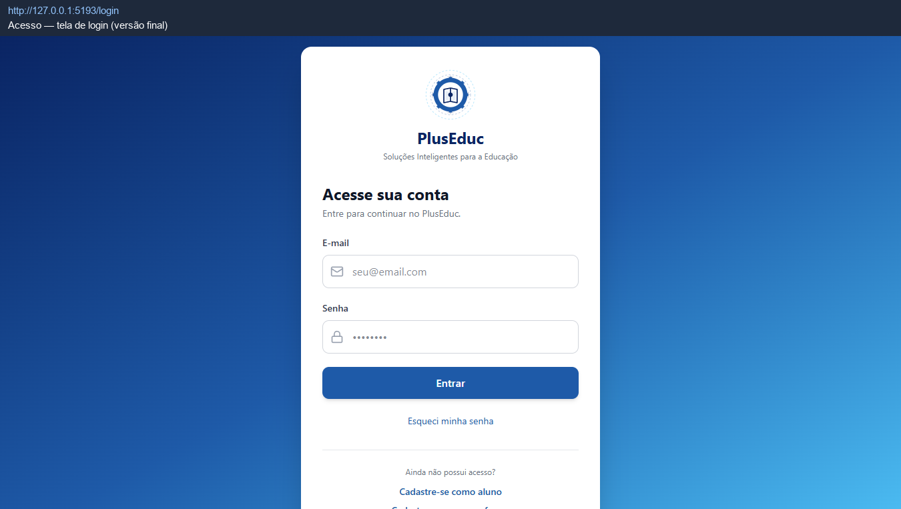

Na primeira vez que o sistema é aberto em uma sessão do navegador aparece uma abertura animada com o logotipo. Ela some
sozinha em cerca de 2 segundos; para pular, clique em **Pular**, pressione **Esc** ou clique na tela.

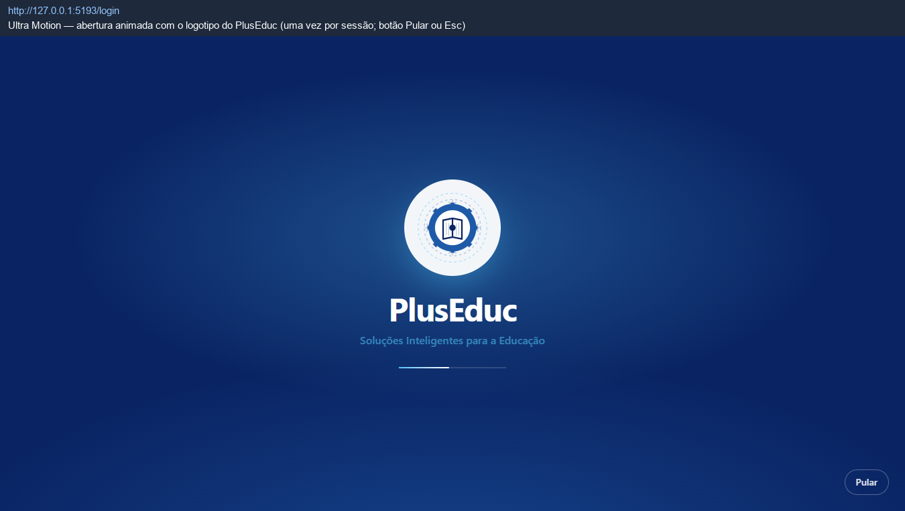

### 3.2 Criar uma conta

Na tela de login há dois atalhos:

- **Cadastre-se como aluno:** nome, e-mail e senha (mínimo de 6 caracteres). O acesso ao portal é liberado na hora e o
  sistema gera a matrícula automaticamente. O aluno passa a ver atividades e notas quando o professor o coloca em uma turma.
- **Cadastre-se como professor:** nome, e-mail e senha. Por segurança, a conta de professor **fica pendente** até a
  coordenação aprovar. Até lá, ao tentar entrar, aparece o aviso *"Seu cadastro de professor aguarda a aprovação de um
  administrador."*

| Cadastro de professor | Login de professor ainda não aprovado |
|---|---|
| 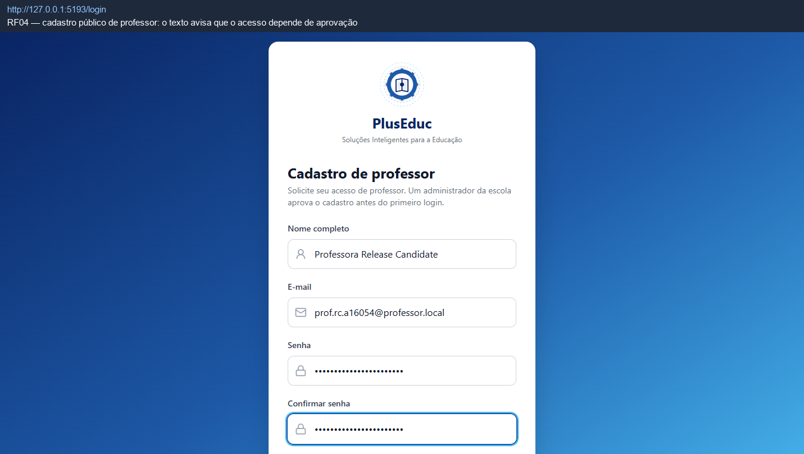 | 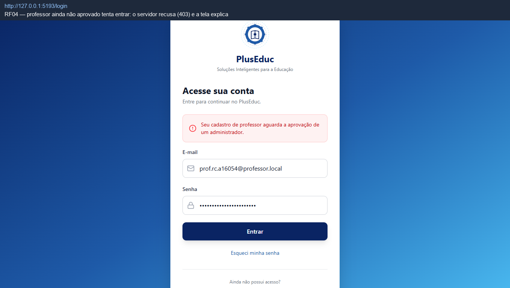 |

Se o aluno já foi cadastrado pela escola (pelo professor, na tela de Turmas), ele **não** se cadastra de novo: o
professor libera o acesso ao portal e informa a senha inicial (veja a seção 5.2). Uma tentativa de autocadastro com esse
e-mail mostra *"Este e-mail já pertence a um aluno cadastrado pela escola. Peça ao professor para liberar seu acesso ao
portal."*

### 3.3 Esqueci minha senha

Clique em **Esqueci minha senha**, informe o e-mail e clique em **Enviar código**. Um código de verificação chega por
e-mail (vale 15 minutos). Digite o código e a nova senha para concluir. Por segurança, a mensagem é a mesma quer o e-mail
exista ou não.

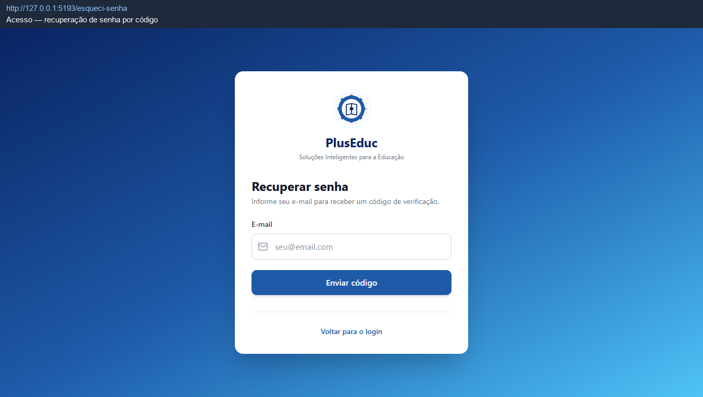

### 3.4 Sessão e saída

A sessão continua aberta enquanto você usa o sistema: o acesso é renovado automaticamente, sem pedir a senha de novo.
Ela termina quando você clica em **Sair**, quando troca a senha ou quando a conta é desativada. Se a sessão terminar,
o sistema volta ao login com o aviso *"Sua sessão expirou. Entre novamente."*

## 4. Visão geral da tela

O menu lateral (à esquerda) leva a todas as áreas. No topo ficam a **pesquisa** (alunos, turmas e atividades) e o
**sino de notificações**, que avisa quando há respostas discursivas esperando correção. Em celulares, o menu abre pelo
botão **Abrir menu**.

| Menu (professor e administrador) | Para que serve |
|---|---|
| **Dashboard** | indicadores, gráficos e alertas das suas turmas |
| **Turmas** | turmas, alunos, matrículas e matérias de cada turma |
| **Atividades** | lista de atividades, criação, geração com IA e correções pendentes |
| **Notas e Frequência** | lançamento e consulta de notas e presença |
| **Relatórios** | relatórios com filtros e exportação |
| **Histórico** | registro das operações que alteraram dados |
| **Minhas matérias** | matérias que você leciona e desempenho dos alunos em cada uma |
| **Configurações** | perfil, tema, senha, animações e saída |

O sistema tem **modo claro e modo escuro** (em Configurações) e funciona em computador, tablet e celular.

## 5. Professor: passo a passo

### 5.1 Dashboard

O Dashboard mostra os números das suas turmas: alunos, atividades, média geral, frequência, taxa de entrega e alunos em
atenção (média abaixo de 6,0 ou frequência abaixo de 75%). Use os filtros de **turma**, **disciplina** e **período** no
topo; todos os gráficos e números respeitam os filtros. No fim da página ficam as atividades recentes e as últimas
operações.

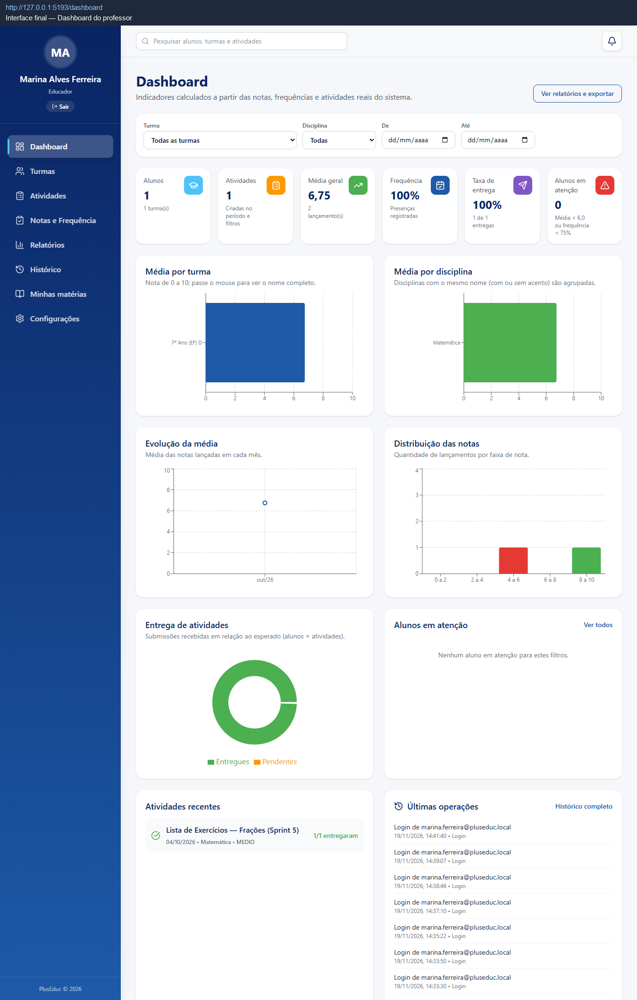

### 5.2 Turmas e alunos

A tela **Turmas** lista as suas turmas, com totais de turmas e alunos, campos de busca e o atalho **Alunos sem turma**.

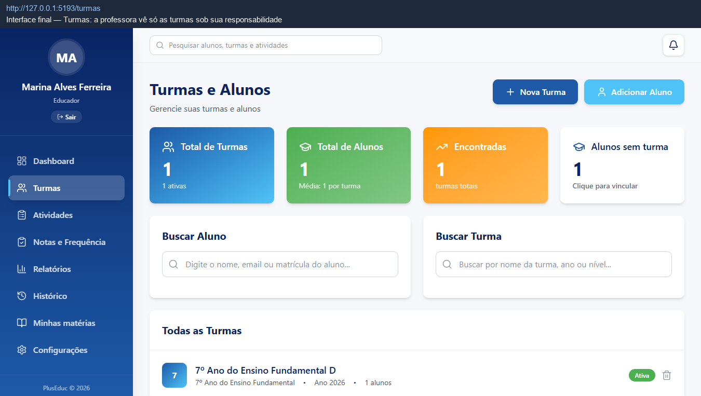

**Criar uma turma**

1. Clique em **Nova Turma**.
2. Escolha a **série** e a **letra** da turma (o nome é preenchido automaticamente) e confira o **ano**.
3. Clique em **Criar Turma**. A turma criada por um professor fica sob a responsabilidade dele.

Cada professor pode ter no máximo **5 turmas ativas**.

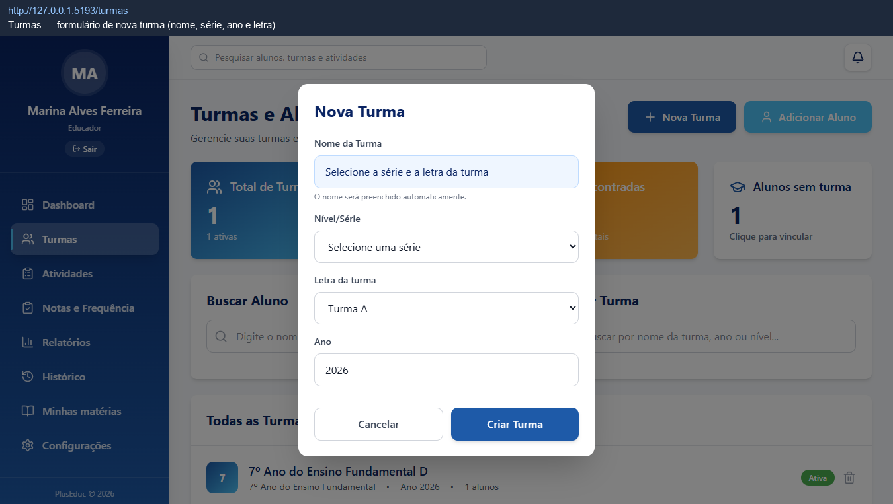

**Cadastrar um aluno**

1. Clique em **Adicionar Aluno**.
2. Preencha **nome completo**, **e-mail** e **data de nascimento**; escolha a **turma** (opcional).
3. Se quiser, registre **lacunas de aprendizagem** (matéria, tópico e gravidade) com **Adicionar**. Elas são usadas na
   recomendação pedagógica e na geração de atividades.
4. Clique em **Criar Aluno**. A matrícula é gerada automaticamente.

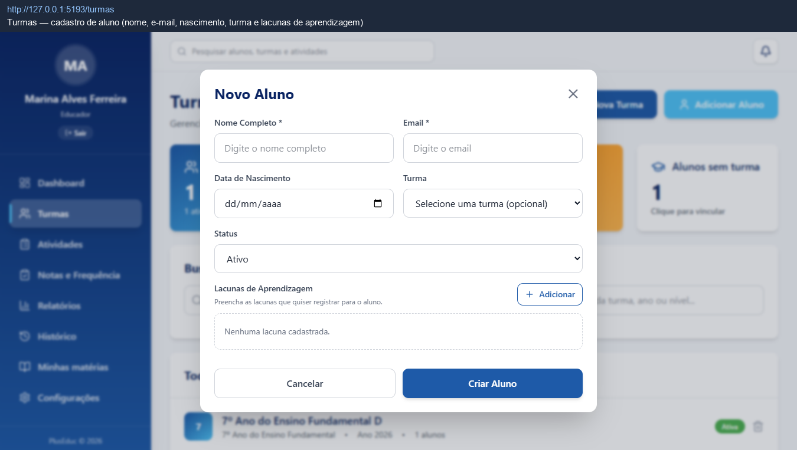

**Ver e organizar uma turma**

Clique em uma turma para abrir o detalhe: número de alunos, matérias da série, **Matérias e professores** (cada matéria
tem no máximo um professor responsável na turma), **Atividades da Turma** e **Alunos da Turma**. Na mesma tela você
matricula alunos sem turma e transfere alunos entre as suas turmas. Um aluno pertence a uma única turma: ao ser
matriculado em outra, ele sai da anterior. Transferir um aluno da turma de **outro** professor é tarefa da coordenação.

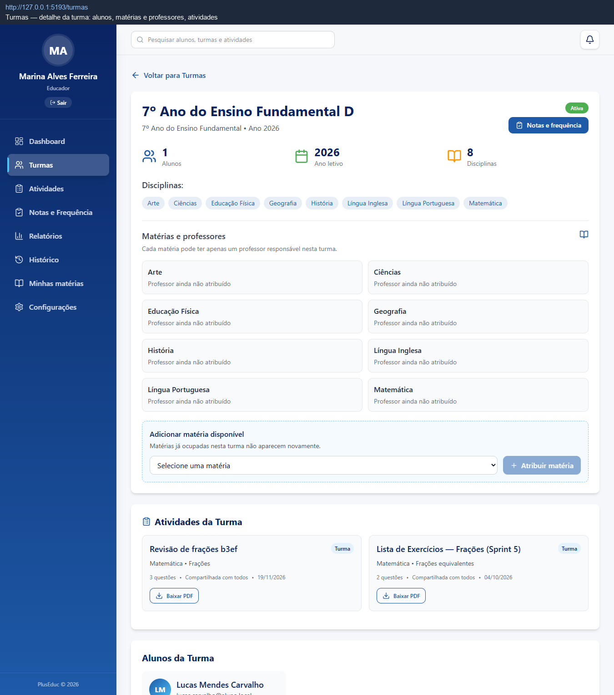

**Liberar o acesso do aluno ao Portal do Aluno**

Um aluno cadastrado pela escola ainda não tem senha. Para que ele entre no portal:

1. Abra a turma e clique no aluno.
2. Clique em **Liberar acesso ao portal** (o botão só aparece para quem ainda não tem acesso).
3. Defina uma **senha inicial** (mínimo de 6 caracteres), confirme e clique em **Liberar acesso**.
4. Informe ao aluno o e-mail cadastrado e a senha inicial; ele pode trocá-la depois em Configurações.

| Aluno sem acesso | Senha inicial |
|---|---|
| 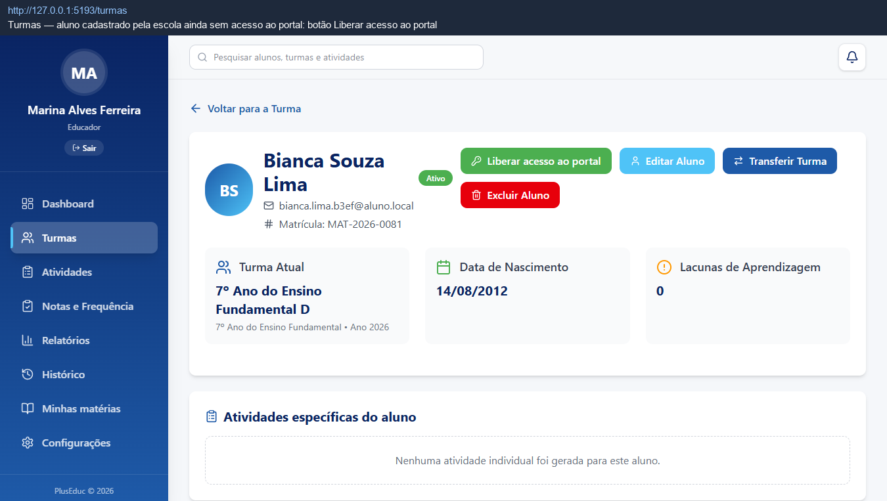 | 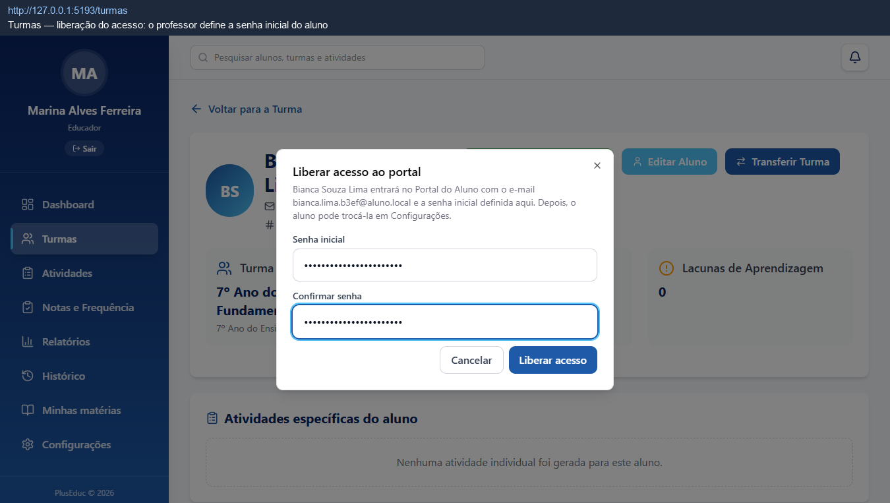 |

Para excluir uma turma, ela precisa estar vazia (sem alunos matriculados). Excluir um aluno o retira da turma e desativa o
acesso dele ao portal; os registros dele (notas, respostas) continuam guardados.

### 5.3 Atividades

A tela **Atividades** mostra o total de atividades, as da semana, as geradas com IA, o painel **Correções pendentes** e a
busca por título, disciplina ou tópico.

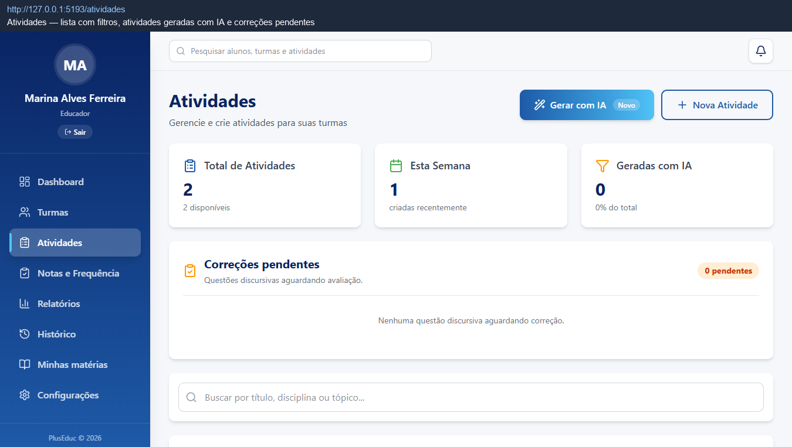

**Criar uma atividade manualmente** (**Nova Atividade**)

1. Em **Dados principais**, informe título (5 a 200 caracteres), matéria, tópico, dificuldade e a **turma** (ou um aluno
   específico da turma).
2. Em **Questões**, escreva o enunciado. Para questão objetiva, preencha as alternativas e marque a correta; para
   discursiva, deixe uma resposta esperada para orientar a correção. Use **Adicionar** para incluir mais questões.
3. Confira a **Preview da atividade** à direita e clique em **Salvar Atividade**.

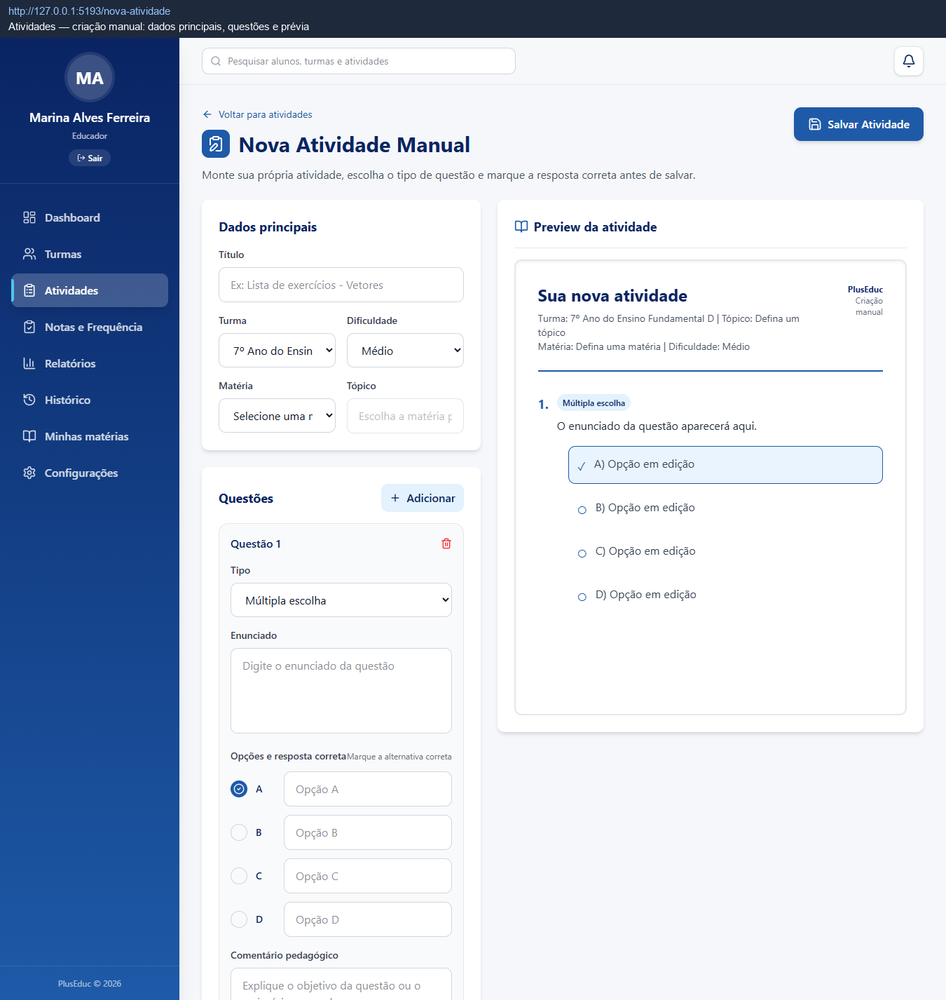

**Gerar uma atividade com IA** (**Gerar com IA**)

1. Escolha a **turma** e o **destino** (turma inteira ou alunos específicos).
2. Escolha a **matéria** e o **tópico**, a **dificuldade**, o **formato** (objetivas, discursivas ou misto) e a
   **quantidade de questões**.
3. Se precisar, marque **Adaptações Inclusivas** (dislexia, baixa visão, TDAH) e escreva **instruções adicionais**.
4. Ao escolher um aluno, o sistema mostra uma **Recomendação pedagógica** (tópico e dificuldade sugeridos a partir das
   lacunas e das notas dele); use **Aplicar recomendação** para preencher o formulário.
5. Clique em **Gerar Atividade**, revise as questões na prévia e confirme com **Gerar e enviar para a turma**.

Sempre revise as questões antes de aplicar. Se o serviço de IA estiver indisponível, o sistema monta a atividade com um
gerador de reserva ou com questões já salvas sobre o mesmo assunto, e avisa na tela.

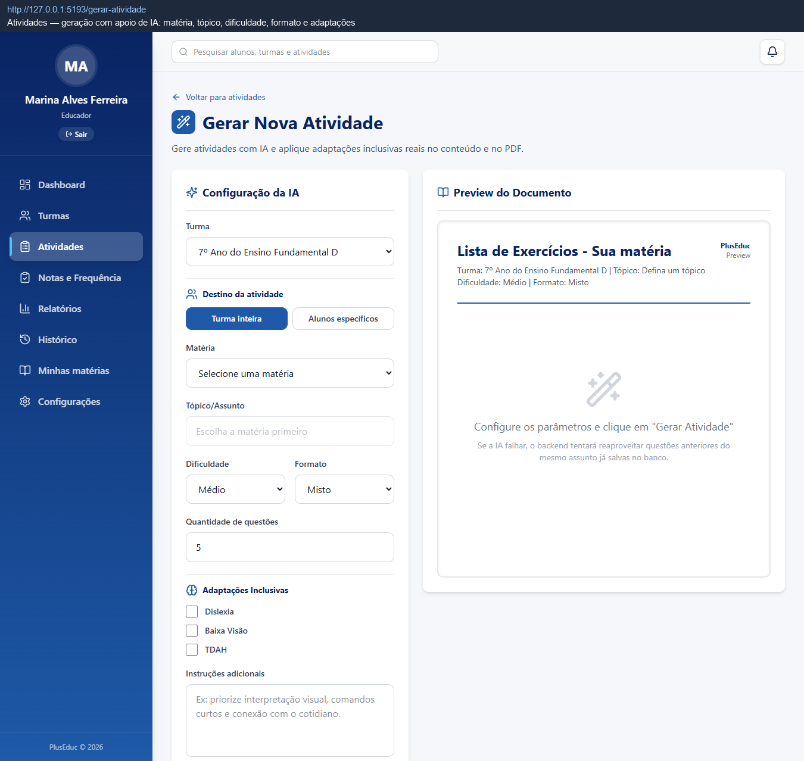

**Acompanhar uma atividade**

Abra a atividade para ver quem já respondeu e quem não respondeu, baixar o **PDF** (para imprimir) e lançar as notas no
boletim. O professor pode resolver a atividade na tela para revisar em sala; essas respostas não são gravadas.

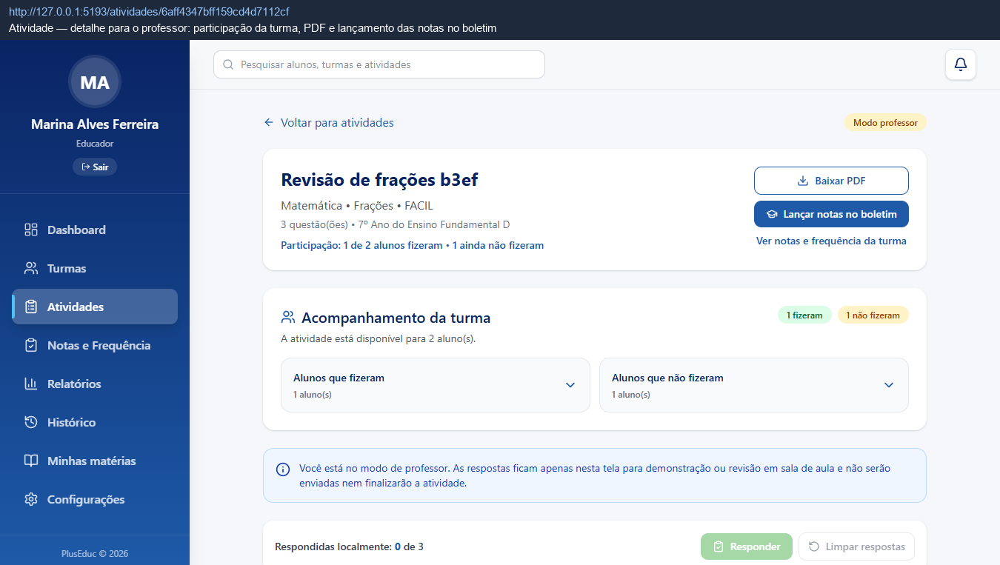

**Corrigir questões discursivas**

As questões objetivas são corrigidas automaticamente no envio. As discursivas aparecem em **Correções pendentes** (tela
Atividades) e no **sino de notificações**:

1. Leia a resposta do aluno.
2. Se quiser, escreva um **feedback** para o aluno.
3. Clique em **Marcar correta** ou **Marcar incorreta**.

| Sino de notificações | Correção da discursiva |
|---|---|
| 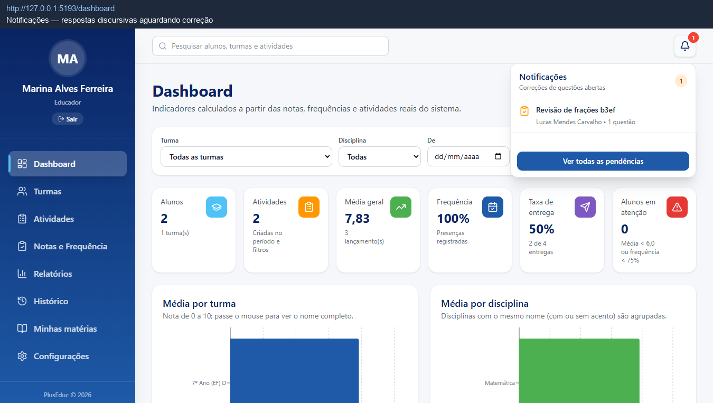 | 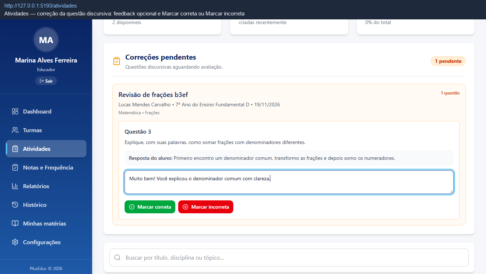 |

**Lançar as notas da atividade no boletim**

No detalhe da atividade, clique em **Lançar notas no boletim**. Cada aluno recebe a nota proporcional aos acertos
(de 0 a 10). Alunos com discursiva ainda sem correção ficam de fora até a correção; lançar de novo não duplica notas.

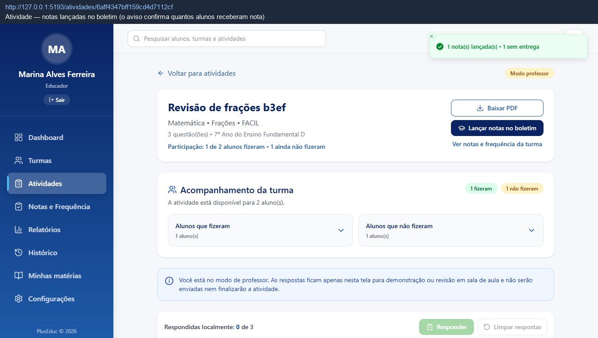

### 5.4 Notas e frequência

Na tela **Notas e Frequência**, escolha a turma para ver alunos, médias e frequência. Para lançar:

1. Clique em **Lançar nota**.
2. Escolha o **aluno**, a **disciplina** e o **tipo** (prova, trabalho etc.).
3. Informe a **nota (0 a 10)** e a **data** (não pode ser futura).
4. Marque a **presença** (Presente, Faltou ou Não registrar) e, se quiser, escreva observações.
5. Clique em **Lançar**.

A média é a média das notas lançadas; a frequência considera só os lançamentos com presença registrada. Médias abaixo
de 6,0 e frequência abaixo de 75% aparecem destacadas. Use **Ver lançamentos** para editar ou excluir um lançamento (a
média é recalculada) e **Exportar boletim** para baixar em CSV, Excel ou PDF.

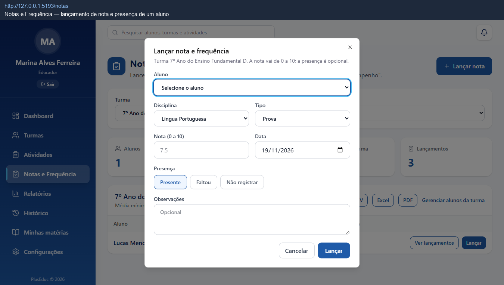

### 5.5 Relatórios

Escolha um dos cinco relatórios — **Boletim por turma**, **Desempenho por disciplina**, **Alunos em atenção**,
**Entregas de atividades** e **Histórico de operações** — e ajuste os filtros (turma, disciplina, período, situação do
aluno). O resultado aparece em tabela, com resumo no topo e busca nas linhas. Clique em **CSV**, **Excel** ou **PDF**
para exportar exatamente o que está na tela.

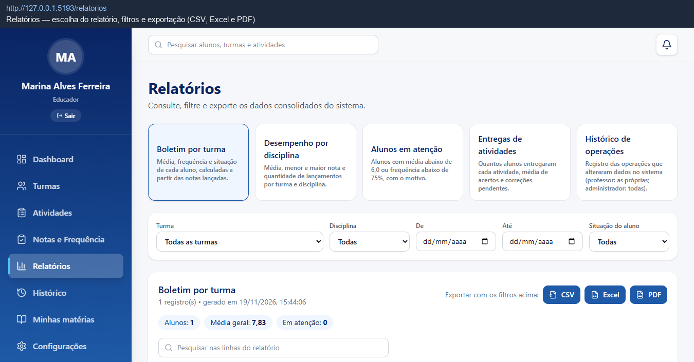

### 5.6 Pesquisa, histórico e matérias

- **Pesquisa:** digite pelo menos 2 letras na barra do topo; o sistema encontra alunos, turmas e atividades, sem diferenciar
  acentos nem a ordem das palavras.
- **Histórico:** lista as operações que alteraram dados (quem, quando, o quê e o resultado); nas notas, mostra o valor
  antes e depois. O professor vê o próprio histórico; a coordenação vê o de todos. O histórico não pode ser alterado.
- **Minhas matérias:** mostra as matérias que você leciona, as turmas de cada uma e o desempenho dos alunos por matéria.
  Também é possível atribuir-se a uma matéria disponível em uma turma.

| Pesquisa | Histórico |
|---|---|
| 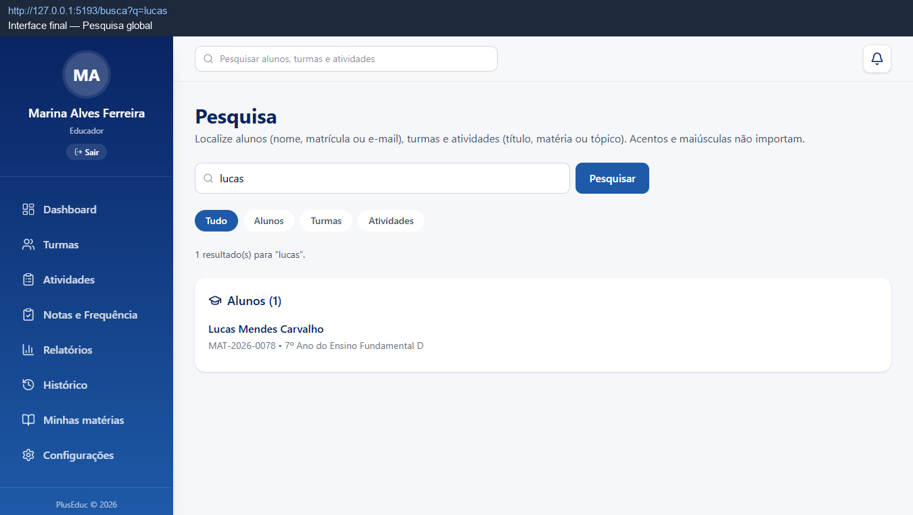 | 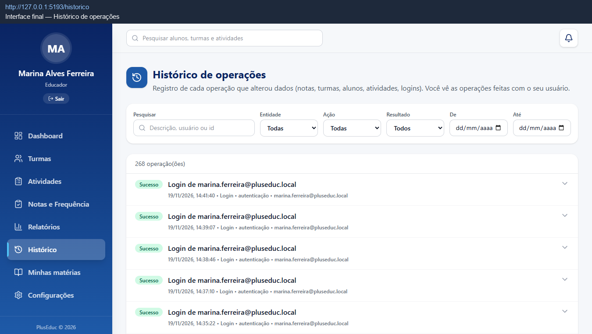 |

## 6. Administrador (coordenação)

O administrador usa as mesmas telas do professor, mas vê **todas as turmas** da escola. Além disso:

- **Aprovar cadastros de professores:** em **Configurações → Cadastros de professores pendentes**, clique em **Aprovar**
  (o professor passa a entrar) ou **Recusar** (o cadastro é removido e o e-mail fica livre).
- **Criar turma para um professor:** no formulário de nova turma aparece o campo **Professor responsável**.
- **Cadastrar, editar e desativar professores** e **alterar ou desativar matérias** do catálogo.
- **Transferir alunos** entre turmas de professores diferentes.
- Ver o **histórico de operações de todos** os usuários.

| Turmas vistas pelo administrador | Aprovação de cadastros |
|---|---|
|  | 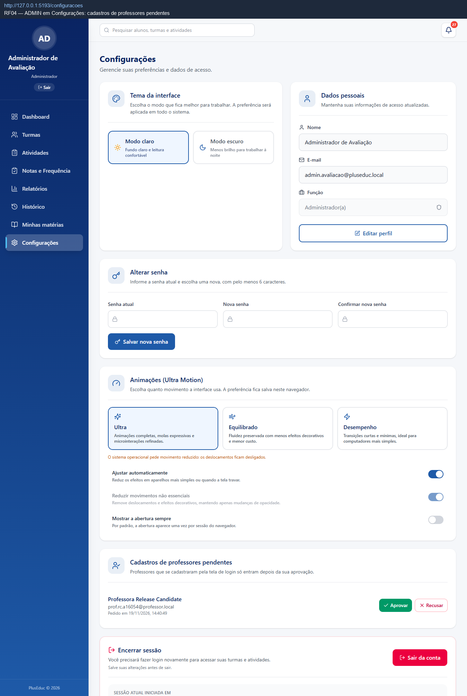 |

O primeiro administrador é criado pela equipe técnica (veja o Manual Técnico).

## 7. Aluno: passo a passo

### 7.1 Portal do Aluno

O menu do aluno tem: **Início**, **Atividades**, **Minha Turma** (colegas, sem dados pessoais deles), **Professores**,
**Minhas Notas**, **Desempenho** e **Configurações**.

| Início | Atividades |
|---|---|
| 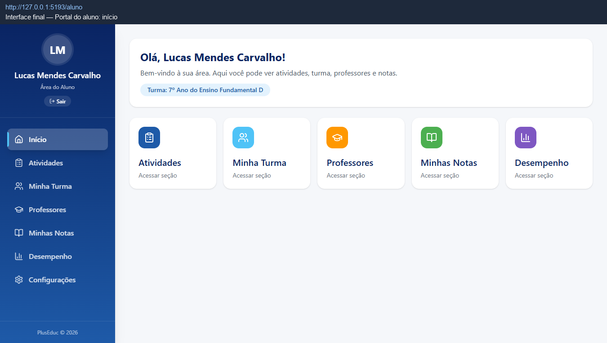 | 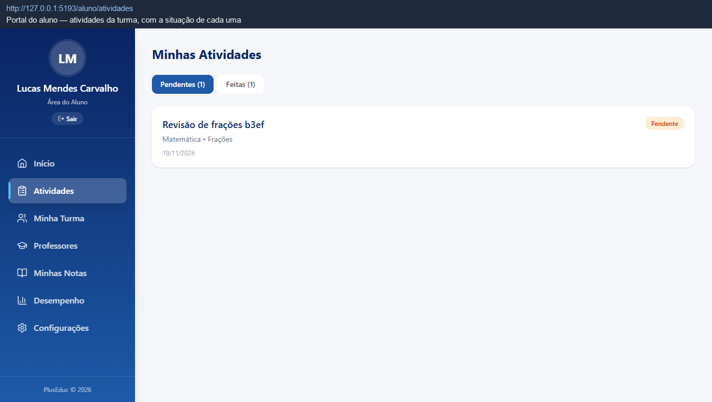 |

### 7.2 Responder uma atividade

1. Em **Atividades**, abra uma atividade pendente.
2. Nas questões objetivas, clique na alternativa; ela fica destacada. Nas discursivas, escreva a resposta.
3. A barra no topo mostra quantas questões já foram respondidas. As respostas ficam guardadas como **rascunho neste
   aparelho**: se a página for recarregada, nada se perde.
4. Quando terminar, clique em **Enviar atividade**. É preciso responder todas as questões; cada atividade só pode ser
   enviada uma vez.

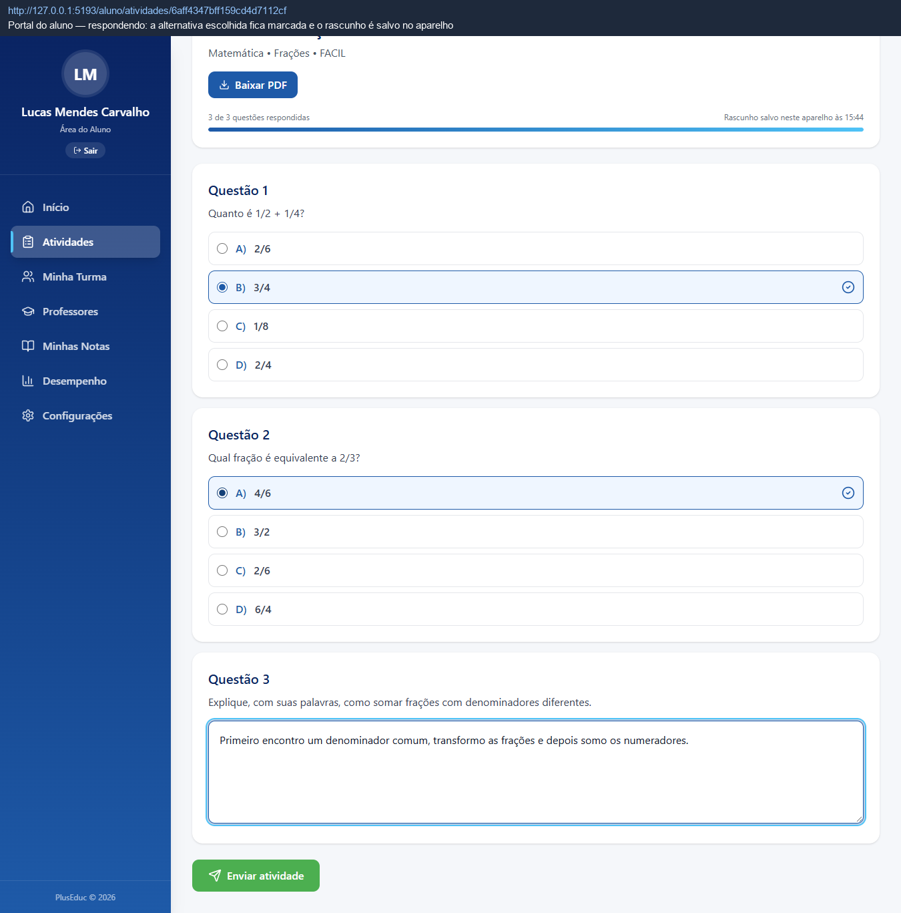

Depois do envio, as objetivas já aparecem corrigidas e as discursivas ficam **aguardando correção**. Quando o professor
corrigir, a atividade mostra o resultado de cada questão e o feedback dele.

| Logo após o envio | Depois da correção |
|---|---|
| 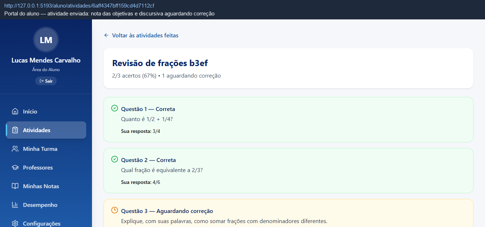 | 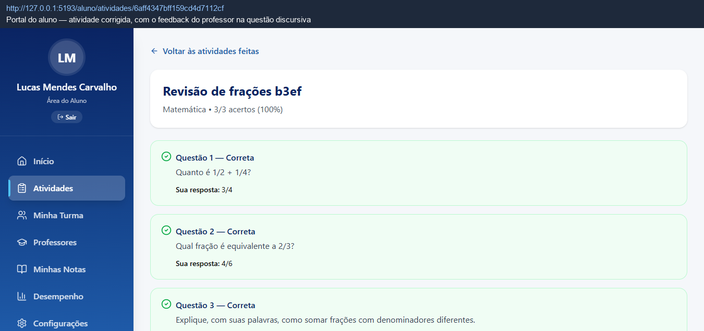 |

A atividade pode ser baixada em **PDF** pelo botão **Baixar PDF** (o PDF do aluno não traz o gabarito).

### 7.3 Notas e desempenho

**Minhas Notas** mostra a média geral, a frequência, os lançamentos e a tabela de notas por disciplina, data e tipo.
**Desempenho** mostra a situação por disciplina.

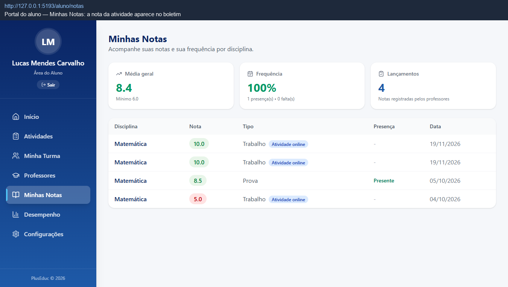

## 8. Configurações da conta

Em **Configurações** (todos os perfis):

- **Tema da interface:** modo claro ou escuro.
- **Dados pessoais:** nome e e-mail (**Editar perfil** e **Salvar perfil**).
- **Alterar senha:** informe a senha atual, a nova senha (mínimo de 6 caracteres) e a confirmação, e clique em
  **Salvar nova senha**. Por segurança, a troca **encerra as outras sessões abertas** (em outros aparelhos); neste
  aparelho você continua conectado.
- **Animações (Ultra Motion):** escolha **Ultra**, **Equilibrado** ou **Desempenho** (para computadores mais simples),
  ligue **Reduzir movimentos não essenciais** ou **Mostrar a abertura sempre**. Se o sistema operacional pedir movimento
  reduzido, o PlusEduc respeita.
- **Encerrar sessão:** botão **Sair da conta**.

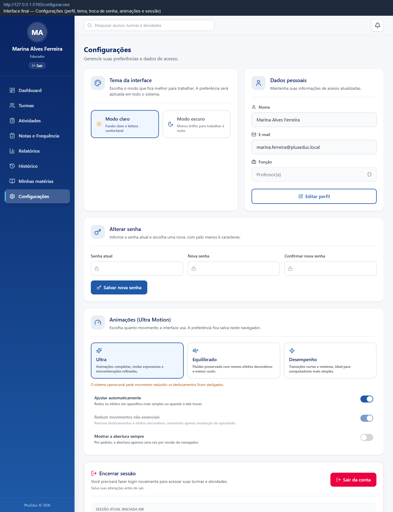

## 9. Mensagens, validações e situações comuns

O sistema confere os dados antes de gravar e explica o problema em português, ao lado do campo ou num aviso no topo da
tela.

| Situação | Mensagem ou comportamento |
|---|---|
| E-mail ou senha errados no login | *"E-mail ou senha inválidos."* |
| Professor ainda não aprovado tenta entrar | *"Seu cadastro de professor aguarda a aprovação de um administrador."* |
| Muitas tentativas de login erradas seguidas (5 em 15 minutos) | *"Muitas tentativas. Aguarde alguns minutos e tente novamente."* |
| Sessão encerrada (saída em outro aparelho, troca de senha, conta desativada) | volta ao login com *"Sua sessão expirou. Entre novamente."* |
| E-mail em formato inválido, senha curta, nome curto, senhas diferentes | mensagem no próprio formulário, indicando o campo |
| E-mail que já tem cadastro | *"Este e-mail já está em uso por outra conta."* ou *"Email já cadastrado"* |
| Autocadastro com o e-mail de um aluno já cadastrado pela escola | *"Este e-mail já pertence a um aluno cadastrado pela escola. Peça ao professor para liberar seu acesso ao portal."* |
| Senha atual errada na troca de senha | *"Senha atual incorreta"* |
| Nota fora de 0 a 10 ou data futura | *"A data do lançamento não pode estar no futuro"* e aviso do campo Nota |
| Nota para aluno de outra turma | *"O aluno não está matriculado na turma informada"* |
| Sexta turma ativa do mesmo professor | *"Limite máximo de 5 turmas ativas por professor"* |
| Excluir turma com alunos | *"Não é possível excluir turma com alunos matriculados"* |
| Turma com nome e ano já existentes | *"Já existe uma turma com este nome e ano"* |
| Matéria que já tem professor na turma | *"Esta matéria já possui professor nesta turma"* |
| Aluno envia atividade incompleta | *"Responda todas as questões antes de enviar"* |
| Professor abre turma ou aluno de outro professor | *"Você não tem acesso a esta turma"* |
| Endereço que não existe | página **"Página não encontrada"**, com atalho para voltar |

| Login com campos vazios | Cadastro com e-mail inválido | Nota acima de 10 |
|---|---|---|
| 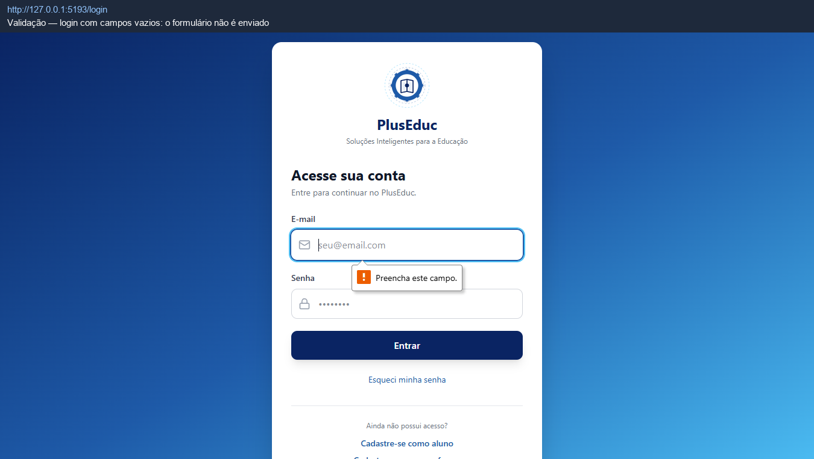 | 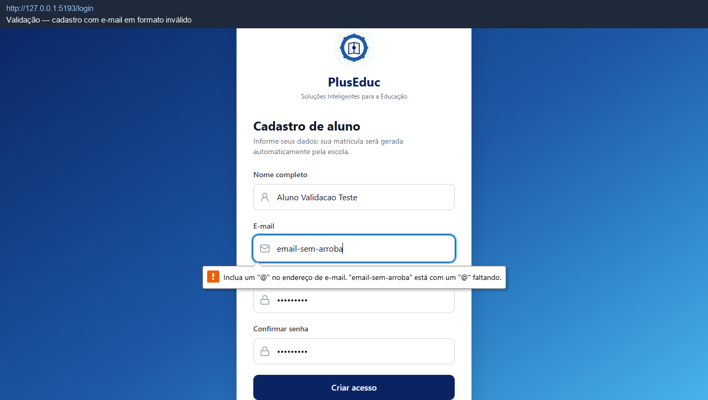 | 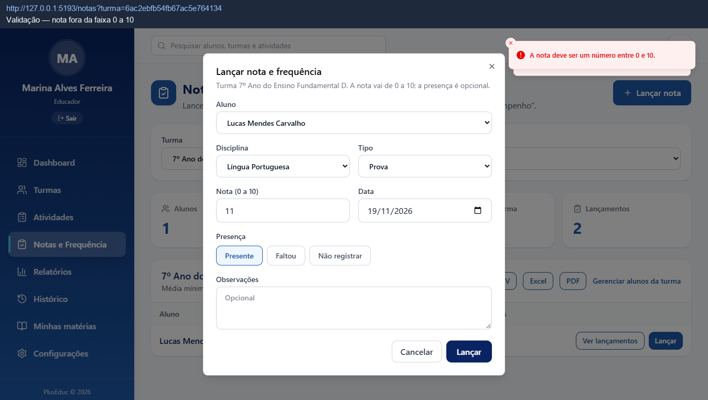 |

## 10. Perguntas frequentes

**Não consigo ver uma turma que existe na escola.** O professor só vê as turmas sob sua responsabilidade. Peça à
coordenação para colocá-lo como professor responsável ou professor de uma matéria da turma.

**Cadastrei-me como professor e não consigo entrar.** O cadastro aguarda a aprovação da coordenação.

**O aluno cadastrado pela escola não consegue entrar.** O professor precisa liberar o acesso ao portal no detalhe do
aluno, na tela de Turmas (seção 5.2).

**O aluno não vê a atividade.** Confira se o aluno está matriculado na turma da atividade (ou se ela foi enviada para ele).

**A nota da atividade não apareceu no boletim.** A nota só vai para o boletim quando o professor clica em **Lançar notas
no boletim**, depois de corrigir as discursivas.

**A geração com IA trouxe questões genéricas.** O serviço de IA pode estar indisponível; nesse caso o sistema usa o
gerador de reserva. Revise e edite as questões antes de aplicar.

**Fui desconectado depois de trocar a senha.** É proposital: trocar a senha encerra as outras sessões. Entre de novo com
a senha nova.
