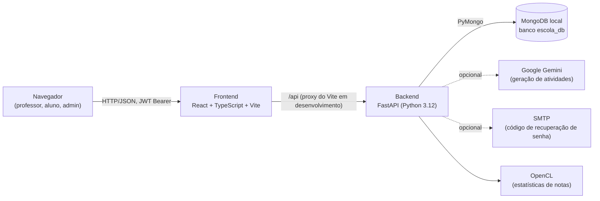
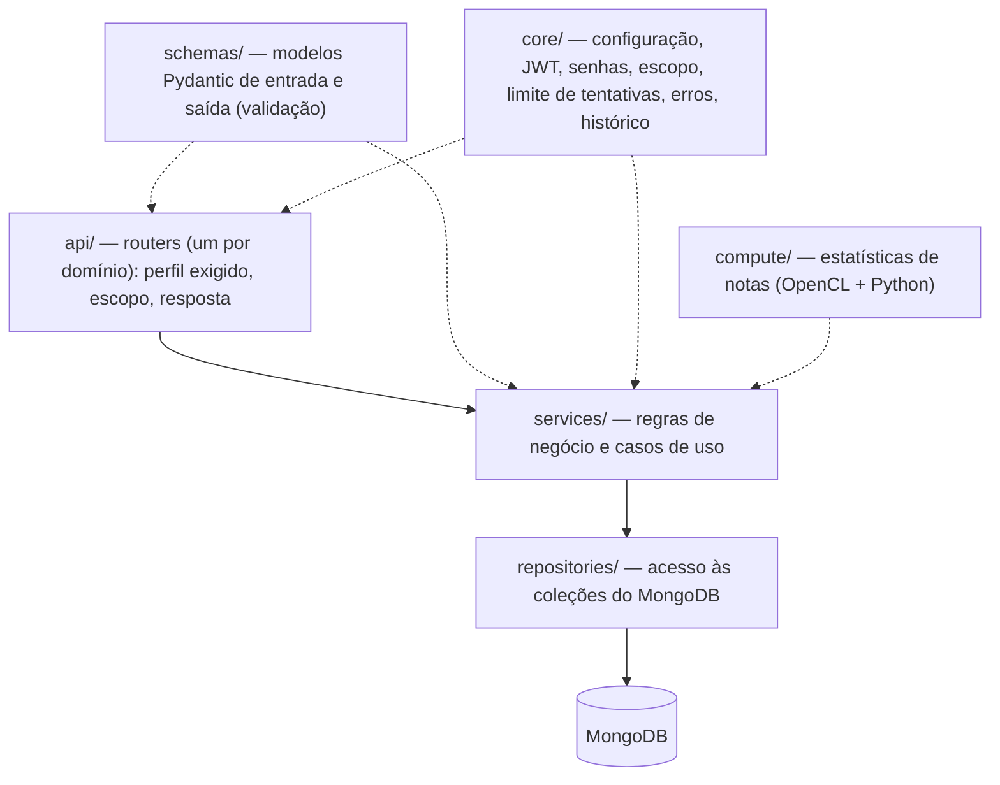

# Manual Técnico — PlusEduc

**Versão:** 1.0.0-rc.1 · **Grupo 08** · Fábrica de Software + Tópicos Avançados · UNINASSAU · novembro de 2026

Este manual reúne o que é preciso para entender, instalar, executar e manter o PlusEduc. Ele descreve a versão da
branch `main` do repositório <https://github.com/PedroBeltraoDev/PlusEduc-MonoRepo>. Os detalhes de cada assunto ficam
nos documentos citados em cada seção (todos em `docs/`).

## Sumário

1. [Visão geral da arquitetura](#1-visão-geral-da-arquitetura)
2. [Tecnologias e bibliotecas](#2-tecnologias-e-bibliotecas)
3. [Organização dos módulos](#3-organização-dos-módulos)
4. [Banco de dados](#4-banco-de-dados)
5. [Requisitos de ambiente](#5-requisitos-de-ambiente)
6. [Instalação e configuração](#6-instalação-e-configuração)
7. [Variáveis de ambiente](#7-variáveis-de-ambiente)
8. [Execução](#8-execução)
9. [APIs](#9-apis)
10. [Componente de IA, processamento e otimização](#10-componente-de-ia-processamento-e-otimização)
11. [Segurança](#11-segurança)
12. [Testes e verificação](#12-testes-e-verificação)
13. [Manutenção e continuidade](#13-manutenção-e-continuidade)

---

## 1. Visão geral da arquitetura

O PlusEduc é um monorepo com três aplicações:

| Pasta | Aplicação |
|---|---|
| `PlusEduc-BE-Python/` | API REST em **FastAPI** (Python 3.12), arquitetura em camadas |
| `PlusEduc-UI/` | interface web em **React + TypeScript + Vite** |
| `PlusEduc-Desktop/` | aplicativo de desktop para Windows (Electron) que empacota a API e a interface |



A comunicação entre interface e API é só HTTP/REST com JSON. Não há WebSocket nem fila de mensagens. O banco é um
MongoDB local. Gemini e SMTP são opcionais: sem eles o sistema funciona, com o gerador de atividades de reserva e sem
envio de e-mail. O OpenCL também é opcional e tem alternativa em Python.

Dentro da API, as dependências apontam sempre para baixo:



Detalhes: [`ARQUITETURA.md`](ARQUITETURA.md).

## 2. Tecnologias e bibliotecas

| Camada | Tecnologias |
|---|---|
| Backend | Python 3.12, FastAPI, Uvicorn, Pydantic 2 e pydantic-settings, PyMongo, PyJWT, bcrypt, httpx (chamada ao Gemini), ReportLab (PDF), openpyxl (Excel), NumPy e PyOpenCL (estatísticas) |
| Frontend | React 18, TypeScript 5 (modo estrito), Vite 6, Tailwind CSS 4, React Router 7, Radix UI (diálogos), Recharts (gráficos), Motion (animações), Sonner (avisos), lucide-react (ícones), next-themes (tema claro/escuro) |
| Banco | MongoDB 6 ou superior |
| Desktop | Electron e electron-builder (instalador Windows); a API é compilada com Nuitka |
| Qualidade | pytest (192 testes), TypeScript em modo estrito sem código não usado, build de produção do Vite, Selenium (regressão pela interface) |

As dependências com versão estão em `PlusEduc-BE-Python/requirements.txt` (execução), `requirements-dev.txt` (testes),
`requirements-compile.txt` (compilação com Nuitka), `PlusEduc-UI/package.json` e `PlusEduc-Desktop/package.json`.

## 3. Organização dos módulos

### 3.1 Backend (`PlusEduc-BE-Python/app`)

| Pasta | Conteúdo |
|---|---|
| `main.py` | cria a aplicação: valida a configuração de produção, liga CORS, histórico e tratamento de erros, registra os routers e (no desktop) serve a interface |
| `api/` | um router por domínio: `auth`, `students`, `student_analytics`, `teachers`, `classrooms`, `grades`, `activities`, `activity_submissions`, `student_portal`, `teacher_corrections`, `subject_catalog`, `subject_topics`, `reports` (dashboard, relatórios e pesquisa), `audit`, `health`; `openapi_docs.py` completa a documentação |
| `services/` | regras de negócio: `AuthService`, `StudentService`, `TeacherService`, `ClassroomService`, `GradeService`, `ActivityService`, `ActivitySubmissionService`, `TeacherCorrectionService`, `ReportService`, `SearchService`, `AuditService`, `PedagogicalRecommendationService`, `GeminiService` e `DemoAIService` (IA), `curriculum` (matérias por série, BNCC), `activity_pdf_service`, `report_export`, `email_service` |
| `repositories/` | um repositório por coleção (consultas, índices, ids em texto ou `ObjectId`) |
| `schemas/` | contratos da API e validações (tamanhos, e-mail, datas, faixas de nota) |
| `core/` | `config` (variáveis de ambiente), `jwt`, `passwords` (bcrypt), `auth` (usuário autenticado), `access` (escopo do professor), `rate_limit`, `database`, `errors` (erro padronizado), `audit_middleware` (histórico), `parallel` (consultas simultâneas), `logging_config` |
| `compute/` | `grade_stats.py`, `opencl_runtime.py` e o kernel `grade_stats.cl` |

`scripts/` traz as ferramentas de operação: `create_admin.py`, `migrate_security_integrity.py`, `check_database.py`,
`seed_demo_population.py`, `export_api_docs.py`, `serve.py` (vários processos), `build_backend.py` e os benchmarks.
`tests/` tem a suíte pytest.

### 3.2 Frontend (`PlusEduc-UI/src`)

| Pasta | Conteúdo |
|---|---|
| `app/routes.tsx` | rotas, com cada tela carregada sob demanda, e a página "não encontrada" |
| `app/pages/` | telas da equipe (Dashboard, Turmas, Atividades, Notas, Relatórios, Histórico, Matérias, Configurações...) e `pages/student/` (portal do aluno) |
| `app/components/` | layouts e menus por perfil, pesquisa, filtros, notificações, cartões de configurações e os componentes de interface em uso (`ui/`) |
| `contexts/AuthContext.tsx` | estado da sessão, login, cadastros e saída |
| `services/` | `api.ts` (cliente HTTP: token, renovação automática da sessão, tradução de erros, downloads), `session.ts` e um serviço por domínio |
| `motion/` | Ultra Motion: abertura, perfis de animação e componentes de transição |
| `hooks/`, `types/`, `utils/`, `styles/` | hooks (rascunho local, chamadas à API), tipos TypeScript, formatação e tema |

A proteção de rotas da interface (aluno não abre telas da equipe e vice-versa) é só conveniência; quem decide o acesso é
sempre a API.

### 3.3 Desktop (`PlusEduc-Desktop`)

`main.js` sobe a API compilada (`PlusEduc-API.exe`) numa porta livre de `127.0.0.1`, espera o `/health` e abre a janela
com a interface servida pela própria API (`STATIC_DIR`). Exige o MongoDB instalado na máquina. Veja o `README.md` da pasta.

## 4. Banco de dados

MongoDB local, banco `escola_db`, com 11 coleções: `users`, `students`, `teachers`, `classrooms`, `subjects`,
`subject_topics`, `activities`, `activity_submissions`, `grades`, `audit_logs` e `refresh_tokens`. As chaves de negócio
(e-mail único, matrícula única, uma resposta por aluno em cada atividade) e os índices são criados pela API ao iniciar.
Como o MongoDB não tem chave estrangeira, a integridade das relações é garantida pelos serviços e conferida por
`scripts/check_database.py` (22 verificações).

Descrição completa (campos, tipos, relações, índices, diagrama e regras de integridade): [`MODELO_DE_DADOS.md`](MODELO_DE_DADOS.md).

## 5. Requisitos de ambiente

| Item | Versão |
|---|---|
| Python | 3.11 ou superior (validado com 3.12) |
| Node.js e npm | 18 ou superior (validado com 22) |
| MongoDB | 6 ou superior, em `localhost:27017` |
| Sistema | Windows 10/11 (comandos abaixo em PowerShell); em Linux/macOS troque `.venv\Scripts\python.exe` por `.venv/bin/python` |
| Opcionais | driver OpenCL com fp64 (GPU), chave da API do Gemini, conta SMTP |

## 6. Instalação e configuração

```powershell
git clone https://github.com/PedroBeltraoDev/PlusEduc-MonoRepo.git
cd PlusEduc-MonoRepo

# Backend
cd PlusEduc-BE-Python
py -3.12 -m venv .venv
.\.venv\Scripts\python.exe -m pip install -r requirements-dev.txt   # requirements.txt basta para só rodar a API
Copy-Item .env.example .env        # edite o .env: no mínimo JWT_SECRET (veja a seção 7)

# Primeiro administrador (a senha é pedida no terminal ou lida de PLUSEDUC_ADMIN_PASSWORD)
.\.venv\Scripts\python.exe scripts\create_admin.py --email coordenacao@escola.local --name "Coordenação"

# Banco já existente de versões anteriores: migração idempotente (sem --apply só simula)
.\.venv\Scripts\python.exe scripts\migrate_security_integrity.py --apply

# Frontend
cd ..\PlusEduc-UI
npm ci
```

Dados de demonstração (opcional): `scripts/seed_demo_population.py`, com a senha comum das contas de demonstração
informada só pela variável `PLUS_EDUC_DEMO_PASSWORD` (veja [`DEMO_DATA_POPULATION.md`](DEMO_DATA_POPULATION.md)).

## 7. Variáveis de ambiente

Toda a configuração vem de variáveis de ambiente, lidas do arquivo `.env` da pasta do backend. O `.env` **nunca** é
versionado (está no `.gitignore`); o modelo, sem valores sensíveis, é o `.env.example`. Não coloque chaves, senhas nem
endereços de produção em arquivos do repositório.

| Variável | Para que serve | Padrão |
|---|---|---|
| `APP_ENV` | ambiente; `production` liga a trava de configuração insegura | `development` |
| `JWT_SECRET` | assinatura dos tokens; **obrigatória**, texto longo e aleatório (em produção, 32 caracteres ou mais) | — |
| `JWT_EXPIRATION_MS`, `JWT_REFRESH_EXPIRATION_MS` | validade do token de acesso e do refresh token | 30 min e 7 dias |
| `MONGODB_URI`, `MONGODB_DATABASE`, `MONGODB_REQUIRED` | conexão, nome do banco e se a API pode subir sem banco | `localhost:27017`, `escola_db`, `false` |
| `CORS_ALLOWED_ORIGINS` | origens do frontend autorizadas | `http://localhost:5173` |
| `TEACHER_REGISTRATION_REQUIRES_APPROVAL` | cadastro público de professor fica pendente até o ADMIN aprovar | `true` |
| `RATE_LIMIT_ENABLED`, `LOGIN_MAX_FAILURES`, `LOGIN_WINDOW_SECONDS` | limite de tentativas de login, cadastro e recuperação de senha | `true`, 5, 900 s |
| `GEMINI_API_KEY`, `GEMINI_MODEL`, `GEMINI_API_VERSION` | geração de atividades com IA (vazio = gerador de reserva) | vazio |
| `SMTP_HOST`, `SMTP_PORT`, `SMTP_USERNAME`, `SMTP_PASSWORD`, `SMTP_FROM_*` | envio do código de recuperação de senha | vazio |
| `PASSWORD_RESET_CODE_TTL_MINUTES` | validade do código de recuperação | 15 |
| `PASSWORD_RESET_DEMO_MODE`, `PASSWORD_RESET_OVERRIDE_EMAIL` | modos de demonstração da recuperação de senha; **só** em máquina local | `false`, vazio |
| `OPENCL_ENABLED`, `OPENCL_MIN_RECORDS`, `OPENCL_DEVICE` | estatísticas em GPU; abaixo do mínimo de registros o cálculo é em Python | `true`, 50000, primeira GPU |
| `LOG_LEVEL` | nível de log | `INFO` |

Frontend (`PlusEduc-UI/.env`, modelo em `.env.example`): `VITE_DEV_PROXY_TARGET` (backend usado pelo `npm run dev`) e
`VITE_API_BASE_URL` (só se a API estiver em outro domínio no build de produção).

Com `APP_ENV=production` a API **não inicia** se `JWT_SECRET` for fraco ou o de exemplo, se algum modo de demonstração
estiver ligado, se o limite de tentativas estiver desligado ou se o cadastro de professor dispensar aprovação.

## 8. Execução

| Situação | Comando |
|---|---|
| API em desenvolvimento | `cd PlusEduc-BE-Python; .\.venv\Scripts\python.exe -m uvicorn app.main:app --reload --port 8080` |
| Interface em desenvolvimento | `cd PlusEduc-UI; npm run dev` (abre em `http://localhost:5173`; `/api` é encaminhado ao backend) |
| API com vários processos | `.\.venv\Scripts\python.exe scripts\serve.py --port 8080 --workers 4` |
| Build da interface | `npm run build` (gera `dist/`; `npm run preview` serve o build) |
| API compilada | `python scripts\build_backend.py` (bytecode), `--nuitka` (código nativo) ou `--standalone` (`PlusEduc-API.exe`) |
| Desktop | `cd PlusEduc-Desktop; npm ci; npm start` (veja o `README.md` da pasta para o instalador) |

Verificação rápida: `http://127.0.0.1:8080/health` devolve o estado da API, do banco e do OpenCL.

## 9. APIs

A API REST tem **100 rotas** em 18 grupos, todas sob `/api` (mais `/health`). A documentação é gerada do próprio código:

| Onde | Conteúdo |
|---|---|
| [`API.md`](API.md) | referência de todas as rotas: perfil de acesso, parâmetros, corpos, respostas e exemplos com `curl` |
| `/docs` e `/redoc` | Swagger e ReDoc servidos pela API em execução, em português |
| [`api/openapi.json`](api/openapi.json) | esquema OpenAPI 3.1, importável no Postman ou Insomnia |

**Autenticação.** `POST /api/auth/login` devolve `accessToken` (30 min) e `refreshToken` (7 dias). As demais rotas pedem
`Authorization: Bearer <accessToken>`. `POST /api/auth/refresh` troca o refresh token por um par novo; cada refresh token
vale uma vez, e reapresentar um já usado encerra todas as sessões daquele login. `POST /api/auth/logout` revoga a sessão.

**Perfis.** `STUDENT` usa só `/api/student-portal/**` e os próprios dados. `TEACHER` usa as rotas de gestão restritas às
turmas sob sua responsabilidade. `ADMIN` vê tudo e é o único que cria, altera e desativa professores, aprova cadastros e
altera o catálogo de matérias.

**Erros.** Sempre no mesmo formato JSON:

```json
{"timestamp": "2026-11-19T18:00:00Z", "status": 400, "error": "Bad Request", "message": "Senha atual incorreta"}
```

Validações (`422`) trazem também `details`, com o campo e o motivo. Excesso de tentativas devolve `429` com o cabeçalho
`Retry-After`.

Para regenerar a documentação depois de mudar rotas: `.\.venv\Scripts\python.exe scripts\export_api_docs.py`.

## 10. Componente de IA, processamento e otimização

Esta é a parte do projeto ligada à disciplina de Tópicos Avançados.

### 10.1 Geração de atividades com IA

`POST /api/activities/generate` (tela **Gerar com IA**) monta uma atividade a partir de matéria, tópico, dificuldade,
formato, quantidade de questões, adaptações inclusivas e, quando há um aluno escolhido, as lacunas de aprendizagem dele.

1. **Montagem do pedido** (`GeminiService.build_prompt`): o texto pede questões corretas e prontas para uso em sala,
   com o formato e a dificuldade escolhidos. Ele inclui as lacunas do aluno para reforçar esses conceitos e regras para
   cada adaptação: enunciados curtos para dislexia, texto limpo para baixa visão, passos curtos para TDAH.
2. **Chamada ao Google Gemini** (`gemini-3.5-flash-lite` por padrão), pedindo resposta em JSON. Há limites de tempo de
   conexão (10 s) e de leitura (45 s).
3. **Validação da resposta:** cada questão precisa ter enunciado e tipo; nas objetivas, alternativas e resposta certa.
4. **Alternativas, nesta ordem:** se o Gemini falhar (sem chave, sem rede, tempo esgotado, resposta inválida), o
   `DemoAIService` gera questões de reserva a partir do tópico. Se ainda assim não houver questões, o sistema reaproveita
   questões já salvas sobre o mesmo assunto. A atividade registra qual fonte foi usada, e a tela avisa o professor.
5. **Adaptação final** (`adapt_generated_questions`): aplica as adaptações inclusivas também ao conteúdo e ao PDF
   (fonte maior para baixa visão).

O professor sempre revisa as questões antes de enviar aos alunos.

### 10.2 Recomendação pedagógica

`GET /api/students/{id}/pedagogical-recommendation` (`PedagogicalRecommendationService`) escolhe o tópico a reforçar com
uma regra explicável. Para cada lacuna do aluno é calculado um escore:

```
escore = 3 × peso da gravidade (alta 3, média 2, baixa 1)
       + max(0, 7 − média do aluno na matéria)
       − 1,5 se a lacuna já foi marcada como superada
```

A lacuna de maior escore define a matéria e o tópico recomendados. A prioridade é **alta** com escore a partir de 7 e
**média** a partir de 4. A dificuldade e a quantidade de questões (5 para prioridade alta, 4 nas demais) seguem a
prioridade e a média. A resposta traz as evidências usadas no cálculo. Sem lacunas cadastradas, a recomendação usa a
média geral do aluno. Na tela **Gerar com IA**, o botão **Aplicar recomendação** preenche o formulário.

### 10.3 Processamento paralelo e em GPU

- **Estatísticas de notas em OpenCL** (`compute/`): média, contagem de presenças e faltas e data mais recente, por aluno
  e por disciplina, calculadas no kernel `grade_stats.cl` (redução por grupo, com `double`). Usadas no dashboard, nos
  relatórios e no portal. Com menos de `OPENCL_MIN_RECORDS` lançamentos, ou sem dispositivo OpenCL, o mesmo cálculo é
  feito em Python. Os dois caminhos são comparados nos testes (`tests/test_opencl_stats.py`).
- **Consultas simultâneas** (`core/parallel.py`): o dashboard e os relatórios buscam coleções independentes ao mesmo
  tempo, num pool próprio de 16 threads.
- **Vários processos** (`scripts/serve.py --workers N`) para atender mais requisições em paralelo.

Medição (Sprint 08, `docs/sprint-08/resultados/benchmark_opencl.txt`, GPU Radeon RX 580):

| Lançamentos | Python (ms) | OpenCL (ms) | Ganho |
|---:|---:|---:|---:|
| 1.000 | 0,63 | 2,80 | 0,23× |
| 10.000 | 6,35 | 11,40 | 0,56× |
| 100.000 | 104,46 | 101,61 | 1,03× |
| 1.000.000 | 1.345,87 | 1.111,07 | 1,21× |

O envio dos dados à GPU só compensa perto de 100 mil registros. Por isso o padrão é usar OpenCL a partir de 50 mil.
A meta de 4× (RNF07) não foi atingida.

### 10.4 Otimização

A formação otimizada de grupos e horários de reforço (RF22), a predição de risco (RF19) e o agrupamento por perfil
(RF21) **não foram implementados**. Estão registrados como pendência em [`REQUISITOS_STATUS.md`](REQUISITOS_STATUS.md).
O ponto de partida previsto é a recomendação da seção 10.2 e as estatísticas da seção 10.3.

## 11. Segurança

- Senhas com **bcrypt**, guardadas só em `users`. Nada de senha em `teachers` nem em texto puro.
- **JWT HS256.** Cada requisição confere assinatura, validade, tipo `access` e `tokenVersion`. O papel usado é o gravado
  no banco, nunca o do token. Trocar ou redefinir a senha e desativar a conta invalidam os tokens já emitidos.
- **Escopo por turma** (`core/access.py`): o professor só atua nas turmas em que é titular, em que leciona uma matéria ou
  que constam no próprio cadastro. Fora disso, recebe 403.
- **Limite de tentativas** em login, cadastro e recuperação de senha. O limite fica em memória, por processo.
- **CORS** restrito às origens configuradas. Erros não expõem detalhes internos. O código de recuperação de senha não vai
  para o log nem para a resposta.
- **Histórico de operações:** toda escrita fica registrada (`audit_logs`), com autor e resultado. O histórico não pode
  ser alterado pela API.
- **Dados de alunos:** o portal não expõe e-mail de colegas, o gabarito só aparece depois do envio e a interface não
  escreve dados de alunos no console.

## 12. Testes e verificação

```powershell
cd PlusEduc-BE-Python
$env:MONGODB_DATABASE = "pluseduc_teste"      # use um banco descartável (cópia do escola_db)
.\.venv\Scripts\python.exe -m pytest -q        # 192 testes

cd ..\PlusEduc-UI
npm run type-check
npm run build
```

Parte dos testes usa o MongoDB real e dados de demonstração. Rode sempre contra uma cópia, nunca contra o banco em uso.
As regressões pela API e pela interface (Selenium), com evidências, ficam em `docs/sprint-08` a `docs/sprint-10`. O
roteiro de capturas dos manuais fica em `docs/sprint-11/scripts`.

## 13. Manutenção e continuidade

**Adicionar uma rota:**

1. Crie o schema de entrada e saída em `schemas/`.
2. Crie a regra em `services/` e o acesso a dados em `repositories/`.
3. Crie o router em `api/`, usando `staff_scope` ou `require_roles`.
4. Classifique o acesso em `api/openapi_docs.py` (se fugir do padrão) e em `tests/test_permissions_sprint8.py`.
5. Escreva os testes, regenere a documentação com `export_api_docs.py` e atualize [`API.md`](API.md).

**Adicionar uma tela:**

1. Crie a página em `app/pages/` e a rota em `app/routes.tsx`.
2. Crie a chamada à API em `services/`, usando sempre o `apiClient`, que já cuida de token, renovação e erros.
3. Rode `npm run type-check` e `npm run build`.

**Mudar o modelo de dados:** prefira campos novos e opcionais. Quando precisar converter dados existentes, escreva um
script idempotente em `scripts/`, como o `migrate_security_integrity.py`. Atualize [`MODELO_DE_DADOS.md`](MODELO_DE_DADOS.md)
e as verificações de `check_database.py`.

**Operação do dia a dia:**
- `check_database.py`: consistência do banco (somente leitura; `--repair` remove só órfãos).
- `create_admin.py`: novos administradores.
- `/health`: estado da API, do banco e do OpenCL.
- `LOG_LEVEL`: nível de detalhe do log.

**Convenções:**
- Código e mensagens ao usuário em português.
- Commits no formato `tipo(escopo): descrição` (`feat`, `fix`, `docs`, `perf`).
- Cada sprint em uma branch, integrada à `main` por pull request.
- Nenhum segredo no repositório.

**Próximos passos técnicos:**
- Integração contínua (GitHub Actions), com um banco mínimo de testes.
- Testes automatizados de frontend.
- Limite de tentativas em armazenamento compartilhado, para mais de um servidor.
- Refresh token em cookie `HttpOnly`.
- RF19, RF21 e RF22.

Situação de cada requisito: [`REQUISITOS_STATUS.md`](REQUISITOS_STATUS.md). Regras de negócio:
[`REGRAS_DE_NEGOCIO.md`](REGRAS_DE_NEGOCIO.md).
